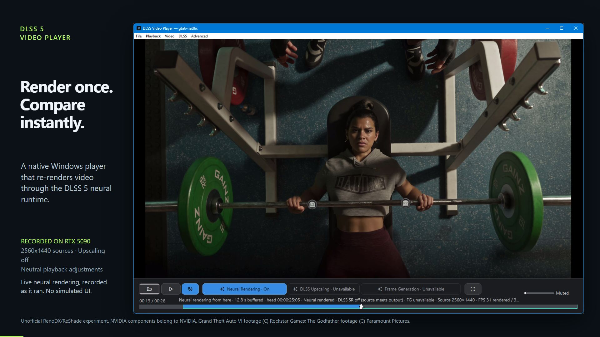

# Player demonstration

> Everything above [AMD captures](#amd-captures) documents the **NVIDIA backend**,
> which this fork does not support: the demo, the preview, the social cuts and the
> comparison stills were all captured on RTX cards. They are kept because they are
> upstream's and show the same player; the AMD backend's own captures are at the
> bottom of this page.

_Verified against 0.28.0 (4f3150a) on 2026-10-02._

[Watch the MP4](neural-comparison-demo.mp4) ·
[Looping preview](neural-comparison-preview.webp) ·
[Poster](neural-comparison-poster.jpg) ·
[Comparison stills](#comparison-stills) ·
[AMD captures](#amd-captures) ·
[How to rebuild it](../../tools/demo-video/README.md)

[](neural-comparison-demo.mp4)

A 24.8-second, silent video: 1920x1080, 30 fps, 744 frames, H.264. GitHub
strips `<video>` tags from Markdown, so the README shows
`neural-comparison-preview.webp` instead: the same cut at 800 px and 8 fps.
The poster is its frame 45. Everything in it was rendered at the player's **default** neural settings.

## What's in it

| Time | Scene |
| --- | --- |
| 0:00–0:04 | *007 First Light*, one paused frame (1122). The divider is across the face from the first frame and sweeps on while the shot slowly pushes in |
| 0:04–0:06.8 | *GTA VI* Trailer 2: Lucia walking toward the camera, playing at full speed (frames 1896–1979) with the divider down the middle, 1:1 source pixels |
| 0:06.8–0:09.8 | The player's **Difference** view (x4, brightness only) of the 007 frame |
| 0:09.8–0:12.6 | The player's **Side by side** view of the same frame |
| 0:12.6–0:16.0 | The player's **loupe** on the same frame, then a punch-in on its two circles |
| 0:16.0–0:21.0 | **Renders while you watch**: a live render of a 16-second GTA VI clip, the picture and the timeline, at 2x speed |
| 0:21.0–0:24.8 | End card |

## How it was made

There are two kinds of picture, and nothing else:

- **The split scenes** (0:00 and 0:04). Left of the divider is the source,
  decoded; right is the same frame of the render the player saved to its cache
  for that source, with the same crop and the same zoom. The render is a
  whole-video render, so source frame *n* is render frame *n*, checked by
  picture.
- **The player scenes** (0:06.8 onwards). Window captures of the player itself,
  at 150% scaling, cropped (the status row is left out), scaled and pushed in.
  The Difference, Side by side and loupe captures are the ones described in
  [screenshot provenance](../screenshots/README.md#24-september-2026-images)
  (frame 1122, after the `f2ae230` playback fix); the current screenshots of
  those views were retaken later.

How the inputs are prepared, checked and composed is in
[the rebuild instructions](../../tools/demo-video/README.md#how-it-fits-together).

The render band scene is a 16-second clip of the GTA VI source (0:14 to 0:30),
cut by stream copy so it is the same encode, opened in the player as a local
file with no render yet. Neural rendering was switched on at the first frame and
playback started; the window was captured every 200 ms. In the player's log the
live render attached 8.3 s after the key press and covered the whole clip 15 s
after it, while the video played. The scene uses the 50 captures from the
moment playback attached (10 s) shown over 5 s, and says 2x on screen. The
GPU was not shared with anything else at the time: an earlier attempt, taken
while another program held most of the GPU's memory, was thrown away.

Nothing was retouched, sharpened or colour-corrected. The GTA VI clip is not
slowed, looped or frozen; the paused frames are paused frames.

| Source | Video | Render |
| --- | --- | --- |
| [007 First Light - Story Trailer](https://www.youtube.com/watch?v=trvIyyFt_MM), PlayStation | 2560x1440 VP9, 59.94 fps, 96.5 s | 5,784 of 5,784 frames verified |
| [Grand Theft Auto VI Trailer 2](https://www.youtube.com/watch?v=VQRLujxTm3c), Rockstar Games | 2560x1440 VP9, 30 fps, 166.8 s | 5,002 of 5,002 frames verified |

Both were fetched through the player's own YouTube feature at its **Auto**
quality and rendered whole with **Convert whole video to neural video** at
default settings (settings digest `96bf471a…` in the cache manifest) on an RTX
4080 SUPER, driver 610.47, runtime lock `310.8.SF-v2`, by the player at
`dced888`. The source files' SHA-256 and the renders' cache keys are in the
[stills' provenance records](stills/). The player scenes and the band clip were
captured the same day with `f2ae230` applied.

## Social

Two files in [`social/`](social/), built by the same Remotion project from the
same inputs as the video (`npm run card`, `npm run square`):

- [`card-1200x630.jpg`](social/card-1200x630.jpg), 90 KB: a link-preview card.
  The *007 First Light* frame 1122 pair from the video, both halves scaled to
  0.62 together, the divider through the face, and the name, one line and a
  provenance line set over a dark gradient on the left.
- [`square-1080.mp4`](social/square-1080.mp4), 13 s, 1080x1080, 30 fps, H.264
  CRF 21, silent, 0.9 MB: the same split face (4 s), the player's Difference
  view (3 s), the PNG the player's **Save comparison image** wrote for the 2 x 2
  view, footer included, scaled to the width (3 s), and an end card (3 s).

Nothing in them is new footage or retouched: they are the video's pairs and
captures, cropped and scaled. Neither is posted anywhere; they are files for
whoever shares the project.

## Comparison stills

Five figures in [`stills/`](stills/), each the source frame beside the same
frame of the player's render, as identical unscaled 700x880 crops. Each has a
`.provenance.json` beside it with the source URL and SHA-256, the frame and its
timestamp, the crop, the render's cache key, SHA-256 and verified frame count,
the neural settings and their digest, the runtime, the GPU and driver, and the
player commit.

| Figure | Trailer, frame | What it shows |
| --- | --- | --- |
| [`007-first-light-bond.png`](stills/007-first-light-bond.png) | 007 First Light, Story Trailer, 1122 (0:18.7) | Skin: pores, the scar, the lips, under lamp light |
| [`resident-evil-requiem-flashlight.png`](stills/resident-evil-requiem-flashlight.png) | Resident Evil Requiem, 2nd Trailer, 4125 (1:08.8) | Night lighting: a face lit from below by a torch |
| [`gta6-lucia.png`](stills/gta6-lucia.png) | GTA VI Trailer 2, 1940 (1:04.7) | Hair and skin at golden hour |
| [`007-first-light-suit.png`](stills/007-first-light-suit.png) | 007 First Light, Story Trailer, 2928 (0:48.8) | Grey hair, a lined face and a wool suit |
| [`ac-shadows-low-key-limit.png`](stills/ac-shadows-low-key-limit.png) | Assassin's Creed Shadows, Story Trailer, 1987 (1:06.2) | **Where it does not help.** A face in deep shadow under a helmet: the render crushes it towards black and adds speckle, while the lit armour barely changes |

The first four are the strongest frames found in those trailers, not typical
ones. The last is there so they are not the only evidence: low-key shots like
it are common in these trailers, and the model makes them worse. The render also
has flaws in the good figures: in the GTA VI one the sweater's left edge breaks
into blotches, and in the Resident Evil one the background above the hair picks
up a smudge.

**How they were made.** Each trailer was fetched at the player's YouTube
**Auto** quality (2560x1440, the highest bitrate at that height) and rendered
whole in a fresh profile, the way
[the demo's sources are](../../tools/demo-video/README.md#you-need), at default
settings: Intensity, Local tone, Local structure and Color strength 1.0, Skin
structure Off, one pass. Every render verified all of its frames. The source and
render were then copied out of the cache, and each figure
was made with
[`tools/demo-video/make-face-comparison.py`](../../tools/demo-video/make-face-comparison.py),
which checks by picture that the render frame is the source frame (it must
differ least at the manifest's offset, 0 for a whole-video render, than one
frame either side), for example:

```powershell
python tools/demo-video/make-face-comparison.py <007>/source.mkv <007 render folder> `
    --frame 1122 --crop 1170,185,700,880 --output docs/media/stills/007-first-light-bond.png `
    --provenance docs/media/stills/007-first-light-bond.provenance.json `
    --source-url https://www.youtube.com/watch?v=trvIyyFt_MM --title "007 First Light - Story Trailer (PlayStation)" `
    --gpu "NVIDIA GeForce RTX 4080 SUPER" --cache-key <render folder name> --player-commit dced888...
```

The other four differ only in trailer, frame and crop, which their records
give. On the two slow 007 shots that check has little margin (for example
4.62 against 4.70 levels at frame 1122), because the source barely changes
from frame to frame; a first choice, frame 1104, failed it and was dropped. The
offset of 0 was confirmed by picture on every trailer, decisively on shots
with motion.

Renders: RTX 4080 SUPER, driver 610.47 (`32.0.16.1047`), runtime lock
`310.8.SF-v2`, the player at `dced888` (0.25.0 plus the unreleased work since).

## AMD captures

Six files in [`amd/`](amd/), all of the **AMD backend**, on an RX 9070 XT
through `LmxxfNrRuntime` — not the NVIDIA path everything above documents. They
are window captures of the player, cropped to the picture: the status row and
the compare bar are left out. All six are frames of *Bumblebee* (2018), a film
rather than one of the game trailers the rest of this page uses — film grain, a
shallow depth of field, and faces lit for a camera instead of for a renderer.

| File | What it is |
| --- | --- |
| [`amd-split-view.png`](amd/amd-split-view.png) | 2121x1190, **Split**: the film in playback, source left of a hard divider, the render right |
| [`amd-2x2.png`](amd/amd-2x2.png) | 2122x1195, **2 x 2**: original, DLSS 5, Difference (4x, luma) and DLSS 5 at Mix 50% |
| [`amd-live-wipe.mp4`](amd/amd-live-wipe.mp4) | The same film in **Wipe**, 6.0 s, 2118x1046, 30 fps, H.264 High, 9.3 Mb/s, AAC stereo 48 kHz. The divider sweeps across the face while the video plays; audio is the source clip's |
| [`amd-live-wipe-preview.webp`](amd/amd-live-wipe-preview.webp) | The animation the README shows: the same cut at 1100x544, 10 fps, 60 frames, looping, lossy WebP, 718 KB, silent. GitHub strips `<video>` tags from Markdown, so the page carries this instead and links it to the MP4 |
| [`amd-face-source.png`](amd/amd-face-source.png) | A face crop from the film, the source frame, 1319x1047 |
| [`amd-face-render.png`](amd/amd-face-render.png) | The same crop of the render, 1321x1048: taken from a frame of the film rather than cut from one pair |

The two halves of Split and Wipe are the same frame: a compare view pairs the
render with the source frame it was made from, so the divider only chooses which
side of that frame you see. That makes the clip usable as evidence without a
frame-by-frame match — whatever is left of the divider is the source and whatever
is right of it is the render, at the same instant.

The 2 x 2 crop shows the panes this backend has. Its fourth pane is the second
Mix rather than RTX VSR, which cannot run here — see [the README's AMD
section](../../README.md#on-an-amd-card).

Nothing was retouched, sharpened or colour-corrected, and the clip is not
slowed, looped or frozen. The preview is the clip resampled and nothing else:
60 frames kept out of 180, Lanczos down to 1100 px, WebP lossy at quality 88 —
38 dB against the same frame decoded from the MP4, so the animation stands in
for the clip rather than replacing its evidence:

```bat
ffmpeg -i amd-live-wipe.mp4 -vf "fps=10,scale=1100:-2:flags=lanczos" ^
    -c:v libwebp_anim -lossless 0 -q:v 88 -loop 0 -an amd-live-wipe-preview.webp
```

## Rights

This is an unofficial RenoDX/ReShade experiment, not an NVIDIA product. *Grand
Theft Auto VI* footage is © Rockstar Games,
*007 First Light* © IO Interactive, *Resident Evil Requiem* © Capcom,
*Assassin's Creed Shadows* © Ubisoft, and the *Bumblebee* frames in
[`amd/`](amd/) © Paramount Pictures. They're used to document the software, and
the source-code licence doesn't relicense them. Only the finished video,
preview, poster, stills and edit source are in Git. The sources and renders are
not.
